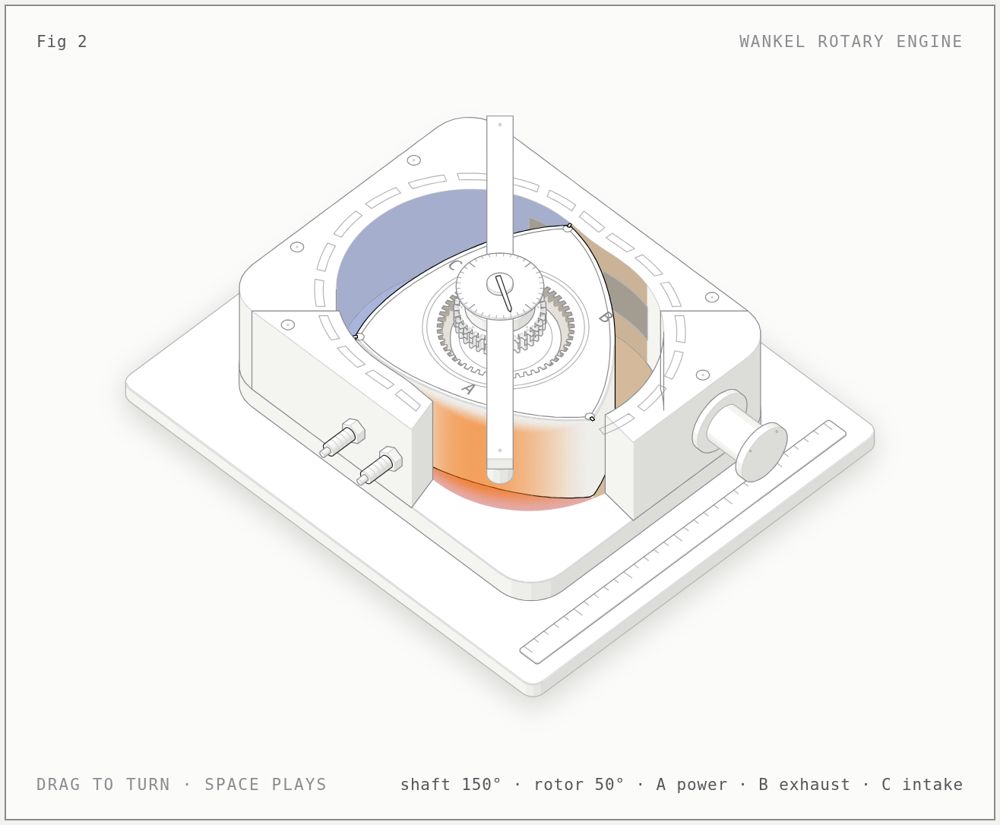

# anatomy-grok-bot

Interactive isometric technical figures for **Cursor** and **Grok Bot**, packaged from the open-source [Anatomy](https://github.com/wheresryan22/anatomy) skill by [@wheresryan22](https://x.com/wheresryan22).



## Credits

**Anatomy was created by Ryan ([@wheresryan22](https://x.com/wheresryan22)).** All of the figure-drawing design, the kit, the references and the examples in this plugin are his work.

- Original repository: <https://github.com/wheresryan22/anatomy>
- Live demo: <https://skills.wheresryan.sh/anatomy>
- Author on X: <https://x.com/wheresryan22>
- License: MIT (original copyright notice kept intact in [LICENSE](LICENSE))

This repository is an **unofficial packaging** of Anatomy for Cursor and Grok Bot by Pedro Gonzalez / Blueforce Innovations. It is not an official release by the original author. See [CREDITS.md](CREDITS.md) and [NOTICE](NOTICE) for details.

## What it does

Ask the agent for an explainer figure, a "how it works" diagram, or an isometric illustration and the `anatomy` skill builds it as a real, finely detailed physical object: solids with four-tone shading, correct painter's order, a framed card with title, hint and live readout, and calm eased motion. Output is a standalone HTML page (dark and light themes) or a lone SVG, framework-free or for React/Next.js, with optional WebGL shaders and an optional 3D mode.

It also bundles the kit's verification tools: a geometry audit (`--audit`), headless-Chrome screenshots, scripted interaction, and a line-end check.

## What's inside

```
.cursor-plugin/plugin.json   plugin manifest
skills/anatomy/SKILL.md      the skill (upstream rulebook + plugin notes)
skills/anatomy/kit/          the Anatomy kit (ESM + TypeScript + React)
skills/anatomy/scripts/      capture, drive, lines, inline-kit, 3D checks
skills/anatomy/references/   craft, kit API, motion, verify, WebGL, 3D, React
skills/anatomy/examples/     8 example figures (sources; build to get HTML)
```

## Requirements

- Node.js 18 or later. No npm install.
- Chrome or Chromium for screenshots and checks (set `CHROME_PATH` if it isn't found).

## Install

**Cursor Marketplace:** once listed, open **Customize**, search for `anatomy-grok-bot`, and select **Install**.

**Cursor, local test** (per [cursor.com/docs/plugins](https://cursor.com/docs/plugins), "Test plugins locally"):

1. Put a real copy of the plugin in `~/.cursor/plugins/local/anatomy-grok-bot` (Windows: `%USERPROFILE%\.cursor\plugins\local\anatomy-grok-bot`). The simplest way:
   ```sh
   mkdir -p ~/.cursor/plugins/local
   git clone https://github.com/plgonzalezrx8/anatomy-grok-bot ~/.cursor/plugins/local/anatomy-grok-bot
   ```
   Don't symlink a checkout from elsewhere: Cursor skips symlinks in that folder whose target is outside it.
2. Restart Cursor, or run **Developer: Reload Window**.
3. Open **Customize** and check that the `anatomy` skill is listed. Invoke it with `/anatomy` in chat, or just ask for an isometric figure.

On Teams/Enterprise, an admin must allow **Allow Local Plugin Imports** (Dashboard → Settings → Security & Identity → Marketplace and Plugins; off by default on Enterprise). If a marketplace plugin with the same name is installed, it takes precedence over the local copy.

**Grok Bot:** no Grok Bot plugin-install flow has been verified yet. What is tested: clone this repository onto the agent's machine and point the agent at `skills/anatomy/SKILL.md`; the skill runs from there with Node 18+ and Chrome.

## Usage

Just ask, for example:

- "Make an interactive isometric figure that explains how a cache key skips work."
- "Draw a how-it-works figure of a rotary engine for our blog post, light theme."

Or invoke it directly with `/anatomy` in Cursor chat.

Sanity-check the bundled kit from the skill folder:

```sh
cd skills/anatomy
node examples/dial-indicator/build.mjs
node examples/arcade-cabinet/build.mjs --audit   # ends "audit passed"
```

## Credit and license

Anatomy is by Ryan ([@wheresryan22](https://x.com/wheresryan22), [GitHub](https://github.com/wheresryan22)), released under the MIT License. Original repository: <https://github.com/wheresryan22/anatomy>. Demo: <https://skills.wheresryan.sh/anatomy>. This plugin is an unofficial, independent packaging by Pedro Gonzalez / Blueforce Innovations and is not an official release by the original author. See [CREDITS.md](CREDITS.md), [LICENSE](LICENSE) (original copyright notice kept intact) and [NOTICE](NOTICE) for exactly what changed.
